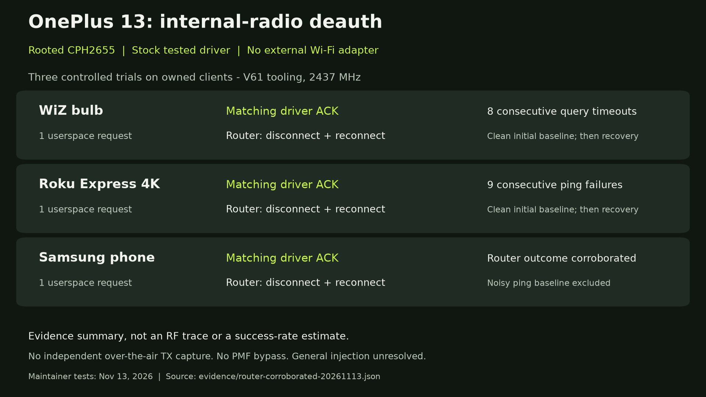

# Deauthentication from the OnePlus 13's internal Wi-Fi radio

[Download the Android preview](https://github.com/Bender1011001/Bender-WiFi-Lab/releases/download/v0.5.2-device-count-preview2/Bender-WiFi-Lab-0.5.2-device-count-preview2.apk) | [Installation guide](docs/INSTALL.md) | [Full source](https://github.com/Bender1011001/Bender-WiFi-Lab/releases/download/v0.5.2-device-count-preview2/Bender-WiFi-Lab-0.5.2-device-count-preview2-public-source.zip) | [Browse app source](bender-wifi-lab/)

**A rooted OnePlus 13, its stock tested Wi-Fi driver, and no external Wi-Fi adapter.** Three controlled client trials produced matching driver acknowledgements and separate router records of disconnection and reconnection. This is the strongest result in this project so far.

The accompanying Bender Wi-Fi Lab preview brings scanning, network dossiers, directed deauth, passive capture and saved work into an Android interface. The radio finding and the latest app release have different validation histories, detailed below.

## What happened

On November 13, 2026, the maintainer tested a rooted OnePlus 13 CPH2655 running Android build `CPH2655_16.0.8.301(EX01)` against three owned clients on a Verizon CR200A. The transmitting phone used its internal Qualcomm radio. Each trial submitted one directed management-frame request from the V61 terminal tooling at **2437 MHz, channel 6**.

| Client | Driver result | Separate observations |
|---|---|---|
| WiZ bulb | Matching ACK reported | Eight consecutive application-query timeouts after a clean baseline, then recovery; router logged disconnect, authentication, association and completed handshake |
| Roku Express 4K | Matching ACK reported | Nine consecutive ping failures after a clean baseline, then recovery; router logged disconnect on 2.4 GHz and reconnection on 5 GHz |
| Samsung phone | Matching ACK reported | Router logged disconnect, reassociation and completed handshake; intermittent baseline ping was excluded as effect evidence |

These are three individual trials, not a success-rate study. “One request” means one userspace submission; firmware retries were not measured. The Samsung model was not independently verified. Normal managed Wi-Fi was restored and the final gateway check received three replies from three pings.

The [sanitized evidence record](evidence/router-corroborated-20261113.json) preserves the environment, tool and driver hashes, aggregate observations, router-event sequences and limitations. The raw logs and captures remain private because they contain household network identifiers. These results were collected by the maintainer, not independently replicated by another laboratory.

## How the narrow working path differs from general injection

The working deauth path submits a management frame through the driver's managed-interface path. Passive capture uses monitor mode. The project switches modes and restores state between these operations; simultaneous managed transmission and monitor capture has not been validated.

An ACK from the driver alone is insufficient to establish a client disconnect. That is why the router records and separate client observations matter. There was no independent over-the-air capture of the transmitted deauth frame. The three pre-transmission captures establish selected-AP/channel observations, not the later transmission itself. Uncalibrated router timestamps also prevent a precise latency or outage-duration claim.

**General monitor-mode packet injection remains unresolved.** A separate November 15 diagnostic with an experimental driver reached firmware but completed with `DISCARD` and ACK false. Peer type 1 and TID 17 were observed; the exact rejecting branch was not identified. That experiment does not justify a firmware patch. See the [diagnostic summary](evidence/general-injection-summary.json).

**No PMF bypass is claimed.** The WiZ and Samsung AP configuration advertised PMF disabled. The Roku AP advertised PMF capable but optional; the client's negotiated protection was not established. A router disconnect does not settle that question.

## The app preview

Bender Wi-Fi Lab `0.5.2-device-count-preview2` is a native Android app with a network-first workflow: scan, select a network, inspect observed devices, choose an applicable action, and keep captures, notes and results with that network. It includes a local runtime installer and encrypted credential storage. Root is required for its Wi-Fi backend. The APK uses an Android development signature.

*UI illustration: the packaged APK in an Android emulator with explicitly synthetic demo data. This is not a live radio demonstration.*

This revision fixes a misleading device count. The previous decoder missed qualifying two-address control traffic and the interface emphasized identified addresses as a device total. The update separates **AP-reported station totals** from **identified addresses**, retains timestamps, and shows unknown when no AP total was captured. Replaying one retained 11,290-frame capture increased identified addresses from 6 to 12. That does not establish the number of physical devices currently connected.

The software checks passed: 40 host engine tests, 201 runtime tests, 76 JVM tests and 54 emulator tests, plus build, lint and package/source checks. Earlier runs of the same 40 engine cases on the phone's bundled ARM64 runtime are retained with unchanged parser/test/runtime hashes.

On November 16, this exact APK was installed in place on the OnePlus. Startup, root/runtime readiness and a full 120-second passive scan passed. The scan captured 7,072 frames; the analysis identified 15 AP records and 9 client addresses, and six AP records supplied station-count reports. Existing saved work was preserved. The phone returned to its original connection, and the gateway replied to all three verification pings.

These handset checks qualify the installation and passive workflow on this build. They do not revalidate the earlier deauth trials or qualify WPS recovery, general injection or another firmware build. The [handset addendum](docs/HANDSET-VALIDATION.md) records the scope and limits. This publication includes the handset addendum; the earlier review archive is retained separately.

Publication checks also caught two delivery issues: omitted source-header aliases and compiler-generated workspace paths inside native helpers. Preview2 includes the aliases, verifies every source-manifest input, and rebuilds those helpers with neutral file paths. Earlier artifacts are preserved separately.

[Install the preview](docs/INSTALL.md) · [Release notes](docs/RELEASE-NOTES.md) · [Claim-by-claim evidence](docs/CLAIMS.md) · [Files and hashes](manifest.json)

## What is distinctive, and what came before

Internal-radio Wi-Fi research on phones has substantial prior art. Nexmon supports monitor/injection on particular Broadcom devices, Kali documents QCACLD injection work on other Qualcomm handsets, and AviumUI documents closely related OnePlus/SM8750 monitor-mode work with firmware-level injection limitations. The [comparison and credits](docs/PRIOR-WORK.md) explain the overlap.

The contribution here is a documented, stock-driver managed-frame path on the tested OnePlus 13, separate router corroboration, and an installable workflow that preserves evidence and recovery state. We are not claiming the first phone to deauth, the first Qualcomm injection implementation, a new CVE, or a universal replacement for external adapters.

## The most useful next result

An independent reproduction on another rooted OnePlus 13, recording exact build, driver, tool version, separate outcome observations and restoration, would be more valuable than a larger unsupported feature list. The [reproduction checklist](docs/REPRODUCTION.md) describes what a useful report should contain. General injection, negotiated PMF experiments, live WPS recovery and broader hardware support remain separate research questions.

Maintained by [Bender1011001](https://github.com/Bender1011001). Development, documentation and review used AI assistants; hardware observations and their limits are identified explicitly. [Attribution and source information](docs/ATTRIBUTION.md) retain upstream credit. No vendor endorsement or external audit is implied.
