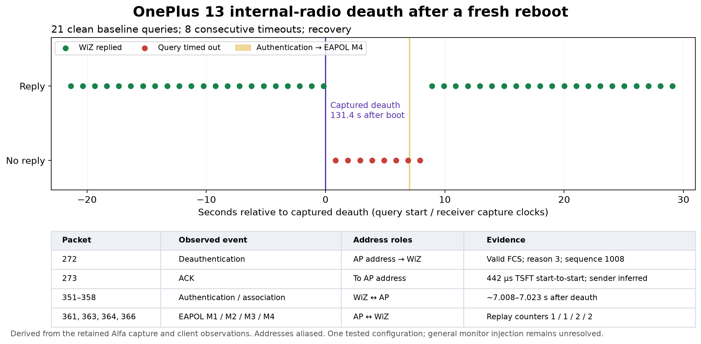
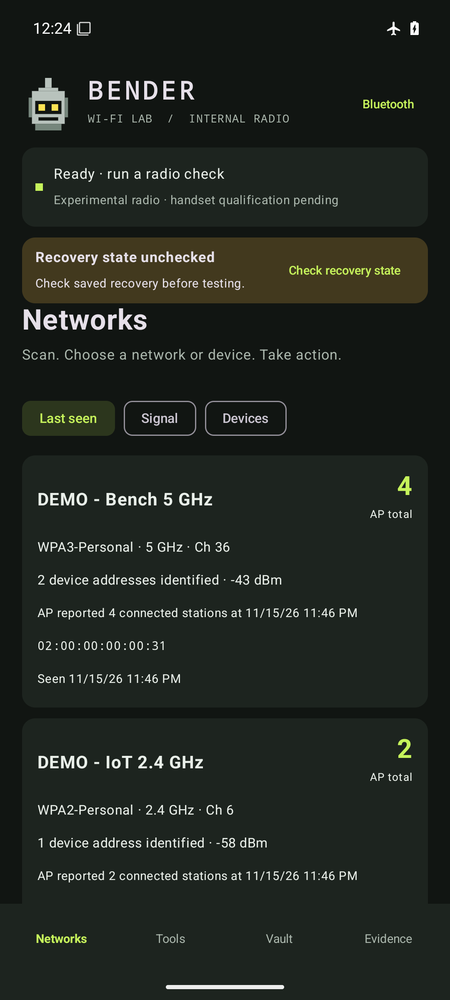

# Deauthentication from the OnePlus 13's internal Wi-Fi radio

[Download the Android preview](https://github.com/Bender1011001/Bender-WiFi-Lab/releases/download/v0.5.4-device-hints-preview1/Bender-WiFi-Lab-0.5.4-device-hints-preview1.apk) | [Installation guide](docs/INSTALL.md) | [Full source](https://github.com/Bender1011001/Bender-WiFi-Lab/releases/download/v0.5.4-device-hints-preview1/Bender-WiFi-Lab-0.5.4-device-hints-preview1-public-source.zip) | [Browse app source](bender-wifi-lab/)

**A rooted OnePlus 13 transmitting through its internal Wi-Fi radio and stock tested driver.** A fresh-boot trial now has independent over-the-air evidence: a separate Alfa receiver captured the directed deauth, following ACK and WiZ client's reconnection exchange. The request ran 131.4 seconds after reboot without internal monitor setup or firmware staging. The phone used USB for ADB; the Alfa was attached to the PC for reception.

[Read the consolidated technical write-up](docs/TECHNICAL-WRITEUP.md) · [Fresh-boot evidence summary](evidence/fresh-boot-air-20261116.json) · [Two-packet appendix](docs/TECHNICAL-WRITEUP.md#appendix-the-two-captured-packets)

The accompanying Bender Wi-Fi Lab preview brings scanning, network dossiers, directed deauth, passive capture and saved work into an Android interface. The radio finding and the latest app release have different validation histories, detailed below.

## Earlier controlled trials

On November 13, 2026, the maintainer tested a rooted OnePlus 13 CPH2655 running Android build `CPH2655_16.0.8.301(EX01)` against three owned clients on a Verizon CR200A. The transmitting phone used its internal Qualcomm radio. Each trial submitted one directed management-frame request from the V61 terminal tooling at **2437 MHz, channel 6**.

| Client | Driver result | Separate observations |
|---|---|---|
| WiZ bulb | Matching ACK reported | Eight consecutive application-query timeouts after a clean baseline, then recovery; router logged disconnect, authentication, association and completed handshake |
| Roku Express 4K | Matching ACK reported | Nine consecutive ping failures after a clean baseline, then recovery; router logged disconnect on 2.4 GHz and reconnection on 5 GHz |
| Samsung phone | Matching ACK reported | Router logged disconnect, reassociation and completed handshake; intermittent baseline ping was excluded as effect evidence |

These are three individual trials, not a success-rate study. “One request” means one userspace submission; firmware retries were not measured. The Samsung model was not independently verified. Normal managed Wi-Fi was restored and the final gateway check received three replies from three pings.

The [sanitized evidence record](evidence/router-corroborated-20261113.json) preserves the environment, tool and driver hashes, aggregate observations, router-event sequences and limitations. The raw logs and captures remain private because they contain household network identifiers. These results were collected by the maintainer, not independently replicated by another laboratory.

## How the narrow working path differs from general injection

The working deauth path submits a management frame through the driver's managed-interface path. Passive capture uses monitor mode. The project switches modes and restores state between these operations; simultaneous managed transmission and monitor capture has not been validated.

An ACK from the driver alone is insufficient to establish a client disconnect. The November 13 trials had router records and separate client observations, but their pre-transmission captures did not record the later deauth. The [November 16 fresh-boot trial](docs/TECHNICAL-WRITEUP.md) adds independent reception of the transmitted frame, an ACK and the target's authentication, association and four-message EAPOL exchange. It also recorded eight consecutive application-query timeouts and recovery. This was one additional controlled trial, not a reliability study; no new router log was obtained for it.

**General monitor-mode packet injection remains unresolved.** A separate November 15 diagnostic with an experimental driver reached firmware but completed with `DISCARD` and ACK false. Peer type 1 and TID 17 were observed; the exact rejecting branch was not identified. That experiment does not justify a firmware patch. See the [diagnostic summary](evidence/general-injection-summary.json).

These results apply to the recorded handset, build and target configurations. They do not establish a new security-boundary bypass or universal device compatibility.

## The app preview

Bender Wi-Fi Lab **0.5.4-device-hints-preview1** uses a network-first workflow: scan, select a network, inspect observed devices, choose an applicable action, and keep captures, notes and results with that network. It includes a local runtime installer and encrypted credential storage. Root is required for its Wi-Fi backend. The APK uses an Android development signature.

This release adds visible WPS progress stages, elapsed time, deadlines and stall information, plus device hints from a bundled vendor-prefix registry and qualified captured metadata. A device card explains its evidence and uncertainty: a component manufacturer's prefix is not proof of a retail brand or model. AP-reported station totals and observed addresses remain separate, timestamped observations.

*Illustration from the earlier preview: synthetic demo data in an emulator, not a live radio demonstration.*

The exact APK passed **404 software tests**: 48 engine, 205 runtime, 91 JVM and 60 emulator tests, with no skips. Package verification matches 1,155 source inputs and 27 assets. On November 17 it was installed over 0.5.3 on the OnePlus. Startup, radio readiness, a 120-second passive survey, saved-record preservation, vendor-hint display and restoration passed. That survey captured 2,285 frames, with 16 AP records and 9 client addresses. The phone returned to its original connection and the gateway replied 3/3.

One older saved capture still produces an import warning because it exceeds the evidence JSON node budget. Its raw evidence is retained; the new survey imported successfully. The [handset report](docs/HANDSET-VALIDATION-054.md) records this issue and the test limits. These checks do not qualify live WPS recovery or app-driven deauth; the transmission finding above comes from the separate terminal experiment.

The [previous 0.5.2 release](https://github.com/Bender1011001/Bender-WiFi-Lab/releases/tag/v0.5.2-device-count-preview2) remains available with its original artifacts. Do not uninstall to downgrade or resolve a signature mismatch: uninstalling removes app data.

[Install the preview](docs/INSTALL.md) · [Release notes](docs/RELEASE-NOTES.md) · [Claim-by-claim evidence](docs/CLAIMS.md) · [Files and hashes](manifest.json)

## What is distinctive, and what came before

Internal-radio Wi-Fi research on phones has substantial prior art. Nexmon supports monitor/injection on particular Broadcom devices, Kali documents QCACLD injection work on other Qualcomm handsets, and AviumUI documents closely related OnePlus/SM8750 monitor-mode work with firmware-level injection limitations. The [comparison and credits](docs/PRIOR-WORK.md) explain the overlap.

The contribution here is a documented, stock-driver managed-frame path on the tested OnePlus 13, separate router corroboration, and an installable workflow that preserves evidence and recovery state. We are not claiming the first phone to deauth, the first Qualcomm injection implementation, a new CVE, or a universal replacement for external adapters.

## The most useful next result

An independent reproduction on another rooted OnePlus 13, recording exact build, driver, tool version, separate outcome observations and restoration, would be more valuable than a larger unsupported feature list. The [reproduction checklist](docs/REPRODUCTION.md) describes what a useful report should contain. General injection, live WPS recovery and broader hardware support remain separate research questions.

Maintained by [Bender1011001](https://github.com/Bender1011001). Development, documentation and review used AI assistants; hardware observations and their limits are identified explicitly. [Attribution and source information](docs/ATTRIBUTION.md) retain upstream credit. No vendor endorsement or external audit is implied.
