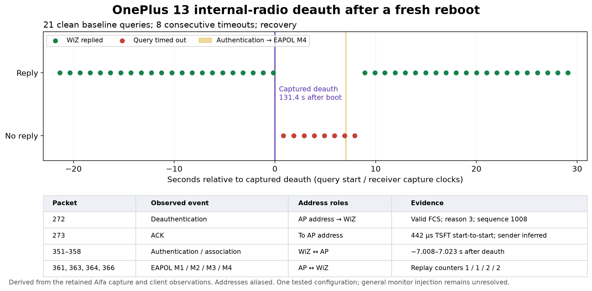
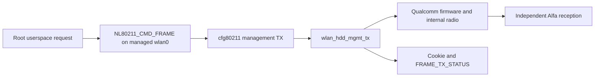

# OnePlus 13 internal-radio deauthentication: fresh-boot and over-the-air validation

**Updated November 17, 2026 · One rooted handset and one tested software build**

A rooted OnePlus 13 transmitted a directed deauthentication frame through its internal Qualcomm Wi-Fi radio **131.4 seconds after a fresh reboot**, using the stock tested driver. No internal-radio monitor setup or firmware staging ran in that boot before transmission. An Alfa adapter on a separate computer captured the frame with the selected AP's source address and BSSID, an immediately following ACK, and the WiZ target's authentication, association and four-message EAPOL exchange. Independent application queries recorded eight consecutive timeouts, followed by recovery.

This extends the November 13 trials, which had driver acknowledgements, client observations and router logs but lacked an independent capture of the transmitted frame. The new capture closes that particular evidence gap. It also demonstrates that an earlier monitor-mode setup is unnecessary in this tested boot sequence.

The phone used its internal radio to transmit. The **Alfa was a receiver attached to the PC**, with zero transmitted packets reported by its interface counters. The phone remained USB-connected for ADB control; this was not an unplugged demonstration. All active tests described here used owned equipment.



*Generated from the retained packet capture and query records, with address roles substituted for household identifiers. This is an analysis figure, not a Wireshark screenshot. The [machine-readable summary](../evidence/fresh-boot-air-20261116.json) records the measurements and source hashes.*

## Tested configuration

| Component | Recorded configuration |
|---|---|
| Handset | OnePlus 13, model `CPH2655`, rooted with Magisk |
| Android build | `CPH2655_16.0.8.301(EX01)`, Android 16 |
| Kernel | `6.6.89-android15-8-g97a9aaefab9a-ab14519050-4k` |
| Internal driver | `qca_cld3_peach_v2`, ordinary managed mode, `con_mode=0` |
| Installed module SHA-256 | `d6bd3fac600aaeba858e83292df167bc410457c07e422047c1a181c31d24d3df` |
| Phone's ordinary connection | 6135 MHz, channel 37, 160 MHz width at the before/after checks |
| Directed test | 2437 MHz, channel 6, owned WiZ bulb and its AP |
| Target security exchange | PSK AKM and CCMP in the captured RSN information |
| Independent receiver | ALFA AWUS036ACS, USB `0bda:0811`, on the PC |
| Receiver software | WSL kernel `6.6.87.2-microsoft-standard-WSL2`, previously qualified rtw88 build, radiotap capture |
| Decoder | TShark 4.6.6, plus a separate direct PCAP/frame-byte and CRC32 check |

Driver and firmware-file hashes matched the saved baseline. The internal firmware search-path override was empty. The existing root installation includes NetHunter and an external-Alfa support module; inspected boot scripts did not stage QCA firmware or reload the internal driver. Consequently, “stock tested internal driver” is the accurate description. This was not a pristine, unmodified Android installation, and no runtime firmware-memory dump was taken.

The active request used a small terminal experiment harness reusing the project's netlink transport and validation helpers. It did not run through the current APK. Harness hashes and raw results are retained separately from app-release validation.

## The working transmit path



The important distinction is the interface used for transmission. The successful request goes through the existing management-frame API on **managed `wlan0`**. It does not use the monitor netdev's packet-transmit entry point.

The driver advertises `AUTH_AND_DEAUTH_RANDOM_TA`, extended feature bit 64. In the inspected OnePlus kernel source, the authentication/deauthentication-specific branch permits a different transmitter address when that feature is present. Other checks still apply, including supported frame subtypes and the driver's management-TX implementation. The feature is one relevant prerequisite, not a promise of arbitrary injection. See the [pinned address-validation source](https://github.com/OnePlusOSS/android_kernel_oneplus_sm8750/blob/6028f47faddaa27700f8dd3a1d83906ea8f27170/net/wireless/mlme.c#L689).

The request selected 2437 MHz and the off-channel TX option while the ordinary connection was on 6 GHz. The caller supplied a directed deauthentication frame with the WiZ address as destination and the selected AP address as source/BSSID. The 100 ms request duration was a management-TX parameter, not an outage duration. Appropriate privileges are required; this experiment ran as root. The API and its permission checks are existing Linux facilities, documented in the [nl80211 definition](https://github.com/OnePlusOSS/android_kernel_oneplus_sm8750/blob/6028f47faddaa27700f8dd3a1d83906ea8f27170/include/uapi/linux/nl80211.h#L768) and [command registration](https://github.com/OnePlusOSS/android_kernel_oneplus_sm8750/blob/6028f47faddaa27700f8dd3a1d83906ea8f27170/net/wireless/nl80211.c#L17270).

The public source snapshots explain the mechanism but are not asserted to be exact source matches for the installed binary. Live acceptance, the matched status frame and the independently received bytes provide the behavioral evidence.

## Fresh-boot experiment

The hypothesis was that directed managed-interface TX would work after an ordinary reboot without first preparing the internal monitor interface or staging firmware.

The receiver was qualified on channel 6 before the trial. An initial reboot was followed by a long interruption, so a second, directly observed reboot defined the actual experiment. Its new boot ID and roughly 90-second uptime were recorded before the trial. The driver, firmware files and boot scripts were compared with the saved baseline.

The Alfa then recorded a bounded capture while a separate PC process issued read-only WiZ `getPilot` queries. There were **21 successful baseline queries** when the submission window began. Fresh AP/client traffic at the selected frequency was required before proceeding. The harness persisted an exclusive transmission-intent record and made **one userspace submission**, with no automatic retry.

The phone returned cookie `256` and a matching acknowledgement-bearing TX status. The reported frame matched the request apart from the driver-assigned sequence number. Submission occurred at **131.4 seconds of phone uptime**. The ordinary managed connection was present at both surrounding state checks.

The capture contains **1,293 packets**, with a first-to-last packet span of approximately **101.216 seconds**. Its filter retained selected-client traffic, selected-AP beacons and ACKs addressed to the AP. Tcpdump reported **zero kernel capture drops**. That statistic does not prove perfect radio reception.

## What the independent receiver captured

| Original packet | Observation | Evidence |
|---|---|---|
| **272** | Directed deauthentication | Source and BSSID equal the selected AP; destination equals the WiZ client; reason 3; sequence 1008; valid FCS |
| **273** | ACK addressed to the AP address | Valid FCS; receiver TSFT advances 442 microseconds from the deauth frame |
| **351, 354, 355** | Authentication requests and successful response | First request about 7.008 seconds after the captured deauth |
| **357, 358** | Association request and successful response | Approximately 7.019–7.023 seconds after deauth |
| **361, 363, 364, 366** | EAPOL messages 1, 2, 3 and 4 | Approximately 7.028–7.043 seconds after deauth; replay counters 1, 1, 2, 2 |

The AP source address in packet 272 differs from the phone's current interface address. Direct extraction of the 26-byte management frame confirmed the requested addresses, subtype and reason code. A separate CRC32 calculation matched the captured FCS.

Two lower-layer changes are visible: the sequence number became **1008**, and the on-air Duration/ID field became **314 microseconds**. The TX-status copy contained the assigned sequence number but retained a zero Duration/ID field. Treating the status copy as a byte-for-byte recording of the final transmitted frame would therefore be incorrect.

The ACK correlation is particularly useful. Both packets were reported at 1 Mbps with a long preamble. The **442-microsecond TSFT difference** is consistent with a 192-microsecond preamble, 240 microseconds for the 30-byte deauth including FCS, and a 10-microsecond interframe interval. The ACK's own FCS also verifies. An ACK has a receiver address but no explicit transmitter address, so identifying its sender as the WiZ client remains an inference from the exchange, not a decoded sender field. Linux's [802.11 header-length implementation](https://github.com/torvalds/linux/blob/v6.6/net/wireless/util.c) distinguishes the shorter ACK/CTS header.

Capture delivery timestamps differ from radio timing: their deauth-to-ACK difference was about 210 microseconds, whereas radiotap TSFT gave 442 microseconds. The report uses TSFT for this immediate frame-pair interpretation and does not claim general calibration of the receiver's clocks.

For the reconnection exchange, all four EAPOL messages were observed with the expected address directions, matching replay-counter pairs, and matching M1/M3 ANonce. Their MICs were not verified, and this test did not recover a password. The capture and later application replies support a completed reconnection.

Exactly one deauth was captured, with its retry flag clear. This is compatible with the one submitted request; it is not proof that the receiver could not have missed another transmission.

## Independently observed client effect

The PC used a fresh UDP socket per query, a 700 ms response timeout and approximately one-second query spacing. Responses were checked against the expected device address and protocol identity. Across the observation period, **43 of 51 queries succeeded**.

Eight consecutive queries timed out after transmission. Their start times ran from approximately **+0.85 to +7.92 seconds** relative to the captured deauth. The first successful recovery query started at approximately **+8.93 seconds**, and the final ten queries all succeeded. These are sampled application observations, not a precise measurement of association downtime.

One additional successful query started after the submission window opened but before the captured RF frame. This accounts for the extra successful point before zero in the plotted timeline; it is not included in the 21-query baseline count.

Together, the matched phone status, independently captured frame, immediate ACK, reconnection exchange and application recovery provide substantially stronger evidence than a driver ACK or a lost ping alone. The clean baseline was an adjacent no-transmission control period; this was not a randomized or repeated reliability study.

## Earlier client trials

On November 13, each of three owned clients received one selected userspace request through the V61 terminal tooling at 2437 MHz:

| Client | Driver observation | Separate evidence retained from that date |
|---|---|---|
| WiZ bulb | Matching ACK | Eight consecutive application-query timeouts after a clean baseline; router disconnect, authentication, association and completed-handshake events; recovery |
| Roku Express 4K | Matching ACK | Nine consecutive ping failures after a clean baseline; router disconnect on 2.4 GHz and reconnection on 5 GHz |
| Samsung phone | Matching ACK | Router disconnect, reassociation and completed-handshake events; noisy baseline ping excluded from effect evidence |

Those were three individual trials, not a success-rate estimate. The Samsung model was not independently verified. Their pre-transmission captures did not record the later deauth, and router timestamps were not calibrated closely enough for precise latency claims. The [historical evidence summary](../evidence/router-corroborated-20261113.json) preserves those limits.

No new router log was obtained for the November 16 trial: Computer Use stopped Chrome inspection because it could not verify the browser URL. The older router records corroborate the older trials; they are not presented as records of this new transmission.

## Monitor reception and general injection

Passive internal-radio reception is a separate established capability. The earlier setup used the driver-created monitor `wlan0` in `con_mode=4`, with radiotap delivery and temporary staging of unmodified firmware/configuration files. That workflow temporarily interrupts the phone's normal connection. It was not used before the fresh-boot transmission reported here.

The inspected stock module's monitor operations table had no `ndo_start_xmit` handler. A November 9 `aireplay-ng --test` run received **0/30 directed-probe responses**; its process exit code of zero did not mean injection succeeded. See the [earlier monitor report](https://github.com/Bender1011001/oneplus13-internal-wifi-research/blob/main/docs/REPORT.md) and [recorded aireplay test](https://github.com/Bender1011001/oneplus13-internal-wifi-research/blob/main/docs/AIREPLAY_TEST.md).

A separate November 15 diagnostic using an experimental driver reached firmware but completed with **`DISCARD(1)`**, status 7 and ACK false. Peer type 1 and TID 17 were observed. The exact first rejecting branch remains unresolved; that trace does not justify a specific firmware patch. Its [diagnostic summary](../evidence/general-injection-summary.json) remains a negative result.

Managed deauth working does not establish arbitrary data/control-frame injection, simultaneous internal monitor RX and managed TX, or compatibility with every conventional monitor-injection tool. The Alfa in this trial supplied independent reception; the phone did not simultaneously capture its own transmission in monitor mode.

## Restoration and procedural issues

The phone was still associated in managed mode after the trial, with an empty firmware override.

The temporary Python runtime setup attempted to isolate its filesystem mounts, but duplicate mounts were visible afterward. A normal unmount removed some; remaining mounts were hidden beneath mount layers. A final ordinary reboot cleared them. A fresh read-only inspection then confirmed **zero leftover runtime mounts**, managed Wi-Fi, unchanged driver/firmware hashes and a **3/3 gateway check**. No further deauth request was made.

The Alfa was returned to its original Windows connection. Temporary receiver modules were unloaded, and the WSL firmware search-path parameter was restored to its exact original value. An initial newline-valued restoration was corrected and verified. These receiver-side preparations did not stage firmware on the phone. Earlier receiver setup and shell-compatibility failures were retained; none was counted as a transmission attempt.

The mount wrapper has since been replaced with a [native isolation helper](../tools/isolated-runtime/README.md). It verifies a new mount namespace, recursive private propagation and each binding before executing the runtime. On November 17, 21 offline Linux tests passed, including partial setup failure and process termination. Subsequent [handset checks](../evidence/harness-isolation-phone-20261117.json) exercised normal completion, command failure and forced termination with the exact Android ARM64 build. The caller's and Android init's mount tables remained unchanged after each case, the original Wi-Fi association/frequency remained, and the final gateway check passed 3/3. These checks used a read-only Python probe and made no new management-frame request. This subsequent correction was **not** used in the recorded November 16 trial, whose original scripts and evidence remain unchanged.

## Contribution, scope and evidence access

The defensible contribution is a documented managed-interface transmit path on this recent handset/build, now supported by a fresh-boot trial and independent RF reception. It is not a claim of the first phone-based injection, a new vulnerability, or universal Qualcomm support.

Relevant prior work includes [Nexmon](https://github.com/seemoo-lab/nexmon), [Kali's QCACLD work](https://www.kali.org/blog/kali-linux-2026-2-release/#the-qcacld30-injection-story), and [AviumUI's related OnePlus work](https://github.com/spiral009/aviumui-wlan-tools/tree/228527778139acd2333593ff1c0982c30a597a3d). The original [Hijacker](https://github.com/chrisk44/Hijacker/tree/898af5b530dd000b8251f21da94626d9e41e53d2) also deserves credit for code and resources used in the derivative tooling. The [prior-work comparison](PRIOR-WORK.md) gives additional context.

This was an ordinary software reboot, not a verified cold power cycle. Only one fresh-boot active trial was performed, on one handset/build and one target configuration. An independently operated laboratory has not yet replicated it. The terminal result also does not automatically qualify a newer APK release; app validation remains separately documented in the [project overview](../README.md).

The original 490,668-byte PCAP, request/status records, per-query observations, boot snapshots and cleanup records are retained locally. The raw PCAP's SHA-256 is:

```text
7979f08c36b420d76b9de15b373fffed1fbaf3cf5986532350bf0954c739dc4a
```

Household addresses, SSIDs, raw handshake material and private paths are omitted from this distributable write-up and its [redacted evidence summary](../evidence/fresh-boot-air-20261116.json). Packet numbers refer to the unchanged private original. Hashes identify retained artifacts; they are not a substitute for access to those originals. No fabricated or address-edited PCAP is presented as the original experiment.

## Appendix: the two captured packets

These are byte transcriptions of **packets 272 and 273** in the hash-identified
original capture. `xx` means one withheld byte, not a zero or a replacement
address. Household MAC addresses and the original FCS bytes are withheld.
Both original FCS values were recomputed successfully from the unchanged private
frames; **the redacted dumps cannot independently establish that checksum result**.
The [machine-readable appendix](../evidence/two-packet-appendix-20261116.json)
and [offline extractor](../tools/extract-packet-appendix.py) preserve this distinction.

### Packet 272: directed deauthentication

Radiotap header, 36 bytes (offset zero is the start of the captured packet):

```text
00 00 24 00 2f 40 00 a0 20 08 00 00 00 00 00 00 80 a7 cd 9c 00 00 00 00 10 02 85 09 a0 00 b8 00 00 00 b8 00
```

IEEE 802.11 frame, 30 bytes including the withheld FCS (offset zero now starts
immediately after that radiotap header):

```text
c0 00 3a 01 xx xx xx xx xx xx xx xx xx xx xx xx xx xx xx xx xx xx 00 3f 03 00 xx xx xx xx
```

| 802.11 byte offsets | Bytes/role | Interpretation |
| --- | --- | --- |
| 0–1 | `c0 00` | Deauthentication; retry bit clear |
| 2–3 | `3a 01` | Duration/ID = 314 microseconds, little endian |
| 4–9 | withheld; client | Receiver/destination |
| 10–15 | withheld; AP | Transmitter/source |
| 16–21 | withheld; same AP | BSSID |
| 22–23 | `00 3f` | Sequence control `0x3f00`: sequence 1008, fragment 0 |
| 24–25 | `03 00` | Reason code 3 |
| 26–29 | withheld | Original FCS verified locally |

### Packet 273: immediately following ACK

Radiotap header, 36 bytes:

```text
00 00 24 00 2f 40 00 a0 20 08 00 00 00 00 00 00 3a a9 cd 9c 00 00 00 00 10 02 85 09 a0 00 b4 00 00 00 b4 00
```

IEEE 802.11 frame, 14 bytes including the withheld FCS:

```text
d4 00 00 00 xx xx xx xx xx xx xx xx xx xx
```

| 802.11 byte offsets | Bytes/role | Interpretation |
| --- | --- | --- |
| 0–1 | `d4 00` | ACK |
| 2–3 | `00 00` | Duration/ID = 0 |
| 4–9 | withheld; AP | Receiver address matches packet 272's transmitter |
| 10–13 | withheld | Original FCS verified locally |

An ACK has **no transmitter-address field**. The client is the inferred sender
from the address relationship and timing; the frame does not explicitly name it.

### Header decoding and timing

Both radiotap headers have presence words `0xa000402f` and `0x00000820`, a
namespace reset and alignment padding. In these exact headers, TSFT occupies
bytes 16–23, flags byte 24, rate byte 25 and frequency bytes 26–27. Flags `0x10`
indicate that FCS is included, with the short-preamble and bad-FCS flags clear;
rate `02` means 1 Mbps, and `85 09` means 2437 MHz. This is a decoding of these
specific layouts, not a fixed-offset rule for arbitrary radiotap headers.

The [radiotap TSFT definition](https://www.radiotap.org/fields/TSFT.html) describes
a receive MAC timestamp in microseconds. The retained values are
**2,630,723,456** and **2,630,723,898**, a difference of **442 microseconds**.
With the reported 1 Mbps rate and long preamble:

```text
Deauth plus following interframe interval:
192 us preamble/header + (30 bytes × 8 us/byte) + 10 us SIFS = 442 us

ACK exchange reserved by the deauth Duration/ID:
10 us SIFS + 192 us preamble/header + (14 bytes × 8 us/byte) = 314 us
```

The byte counts include the four-byte FCS. Linux's
[802.11 duration calculation](https://github.com/torvalds/linux/blob/v6.6/net/mac80211/util.c)
uses the same long-preamble and SIFS terms. These agreements support correlation
of the frame pair; they do not independently calibrate the receiver's clock.
The PCAP delivery timestamps differ by **210 microseconds**, so that interval
must not be substituted for the TSFT calculation.

The requested frame had Duration/ID zero and sequence zero. The TX-status copy
had sequence 1008 but Duration/ID zero; the captured frame had sequence 1008 and
Duration/ID 314. That comparison does **not** locate the responsible code within
the driver, firmware or hardware. Likewise, the requested 100 ms off-channel
duration is not a measurement of actual radio dwell.
